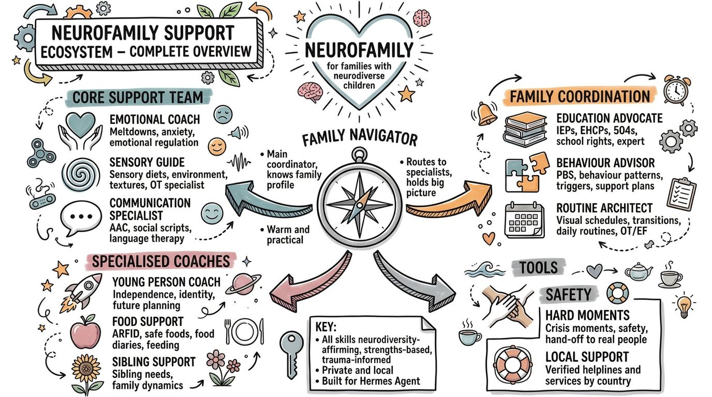

# NeuroFamily Support Ecosystem (Hermes edition)

A multi-agent support ecosystem for families raising neurodiverse children. Built with love for families who deserve support that actually supports them.



---

## What this is

Sixteen specialist support skills that run on **[Hermes Agent](https://hermes-agent.nousresearch.com/docs)**, your own personal AI assistant. Install it once, and the family has a complete support team through the chat app you already use (Telegram recommended).

Think of it as a multidisciplinary team in your pocket: a family coordinator, a school advocate, an OT for sensory and routines, a coach for emotional regulation, a feeding specialist, a carer wellbeing companion, and more, all working together and all sharing one picture of your family.

**Private by design.** Everything runs on your own machine. Your family's information stays with you.

**The Family Navigator** is the front door. It gets to know your family, routes each need to the right specialist, and holds the big picture across everyone.

---

## Privacy first

This is a folder of documents about a child's disability. It is the most sensitive material most families will ever put on a computer, so it is worth being blunt about how it is handled.

**Everything sits on your own machine.** The family folder, the profiles, the notes, the private reflections: all local files under `~/neurofamily/`. Nothing is sent anywhere except the messages you choose to type into the model you chose.

Four layers, in the order they apply.

### 1. De-identification, built into the team

Before onboarding begins, and again before it reads any school, medical or NDIS document, the agent asks one question: *do you want this de-identified?* The answer is written to `~/neurofamily/deidentification.md` and holds for the session. Silence is not consent: unanswered means de-identified. The convention itself lives in `shared/deidentification.template.md`.

Saying no is allowed. If you do, it says once that the model provider will then see the real details, and carries on.

### 2. Private partitions the paper cannot read

`~/neurofamily/` has three rooms:

| Where | Who it is for | Printed or summarised? |
|---|---|---|
| `~/neurofamily/` and `shared/` | The whole family | Yes, including the Morning Edition |
| `~/neurofamily/private-parent/` | The carer only | Never |
| `~/neurofamily/private-yp/` | That young person only | Never |

A carer's burnout note and a young person's private reflections belong in different rooms from the family calendar. `scripts/setup-family-folder.py` creates all three, with the two private ones mode `0700` on POSIX, and `scripts/build_paper.py` refuses at the code level to read anything inside a private partition. That is deliberate: a rule in a prompt can be argued with by a later edit, and a guard that raises cannot.

What may travel from a private note into shared ground is the *operating conclusion* ("we need to reduce Tuesday mornings"), never the *disclosure* ("dad cried in the car").

### 3. Local redaction, before a document is ever attached

Asking whether to de-identify a document **after** it arrives is too late. Attaching the file is the moment it leaves the machine, and by then the provider already has it.

`scripts/redact_doc.py` runs on your own computer first:

```bash
python scripts/redact_doc.py NDIS-plan.pdf --names "Sarah Whitmore, Amelia, Reservoir High School"
```

It writes `NDIS-plan.redacted.md` beside the original. Attach that, never the original.

**It removes:** NDIS participant numbers, Medicare numbers, Centrelink CRNs, labelled dates of birth, email addresses, Australian mobile and landline numbers, street addresses and state postcodes, and every name passed in `--names`. A school becomes `[SCHOOL_A]`, a plain name `[CHILD_A]`, and a titled adult such as `Dr Whitmore` becomes `[PERSON_A]`. A surname shared by two people becomes `[SURNAME_A]` rather than being quietly attributed to one of them.

**It leaves alone, deliberately:** ordinary dates, because review dates are the substance of a plan; and 1300, 1800 and 13 service numbers, because one of them is the NDIS line and redacting it would be worse than useless.

Standard library only. `.txt`, `.md`, `.csv` and `.html` work out of the box; `.pdf` needs `pypdf`, `PyPDF2` or the `pdftotext` binary, and the script names which is missing rather than pretending it redacted something it never read. It prints counts and never values, so the terminal stays safe to screenshot.

**It is a pattern matcher, not a guarantee.** A scanned PDF has no text layer, a nickname slips past a supplied name list, and a bare suburb is left alone. Read the output before sending it, and treat `0 items matched` on a real plan as a warning rather than a clean bill of health.

### 4. Zero data retention, at the provider

If you use a hosted model, the provider's retention setting is the last gate. **Cheaper Inference keeps a copy of every request by default.** Turn zero data retention on *before* your first request, in the dashboard under **Data Protection**. It applies from the moment you enable it, it does not delete what was already kept, and it narrows the models available and may change the price.

The reason all four layers exist, in Cheaper Inference's own documentation:

> ZDR does not detect, mask, or anonymize PII; there is no automatic pre-provider PII redaction. Remove sensitive data in your application before sending it, including tool results and attachments.

Zero retention stops them keeping it. It cannot stop you sending it. Redaction is the layer that removes the details; zero retention is what stops a copy accumulating afterwards.

If nothing should leave the house at all, use a local model instead: `INSTALL.md` Step 5. No account, no request, no provider.

### What this does not claim

It lowers exposure. It does not make anyone anonymous. An age, a suburb, a school type and a diagnosis can still point at one young person in a small town. Give only what the task in front of you needs, and if you have already sent something you would rather not have, say so: the agent can help with what it knows, and cannot help with what it does not.

---

## The support team

| Skill | Focus |
|---|---|
| Family Navigator | Whole-family hub, triage, coordination |
| Emotional Coach | Regulation, anxiety, meltdown recovery, emotional literacy |
| Sensory Guide | Sensory profiles, sensory diets, environment, fine motor |
| Communication Specialist | AAC, speech and language support, social scripts |
| Education Advocate | IEPs, EHCPs, 504s, ILPs, accommodations, school rights |
| Behaviour Advisor | Behaviour patterns, functions, proactive support plans |
| Routine Architect | Visual schedules, transitions, executive function |
| Young Person Coach | Self-advocacy, identity, independence, transition planning |
| Food Support | ARFID, safe foods, food diaries, low-stress mealtimes |
| Sibling Support | Siblings' feelings, identity, fair attention |
| Parent Companion | Carer burnout, grief, respite, wellbeing |
| Hard Moments | Crisis moments, safety, hand-off to real people |
| Local Support | Verified helplines and services by country |
| NDIS Guide | Australian scheme navigation: access, plans, budgets, reviews, from the shipped document library |
| Morning Edition | The printed A4 morning paper, and changing what it carries |
| Artifacts Generator | Visual schedules, trackers, dashboards, family mini-apps |

Every skill is neurodiversity-affirming, strengths-based and trauma-informed. See `SOUL.md` for the principles and `AGENTS.md` for how the team works together.

---

## How it works

1. **One shared brain.** All skills read and update a shared family folder (`family-profile.md`, `child-summary.md`, `active-concerns.md`, `deidentification.md`, and more). When one specialist learns something important, the others know.
2. **One front door.** The Family Navigator handles first conversations, profiles your family, and routes to specialists.
3. **Schedules for real family life.** Optional check-ins and nudges through Hermes cron jobs: morning routine anchors, a weekly family check-in, carer wellbeing prompts, and a monthly review. See `schedules/`.
4. **Escalation rails.** The team supports; it never diagnoses, treats or replaces professional care. Crises route to humans immediately. See the rails in every skill.
5. **Optional connections.** With a free Maton account, the team can read the family's Google or Microsoft calendar and mail (real appointments in the weekly check-in, school emails summarised before meetings). Read-first, writes need a yes in the moment. See `docs/connections.md`.
6. **A model for every job.** DeepSeek Flash via OpenRouter by default, frontier models on demand for complex work, and local models encouraged for the scheduled check-ins. Voice is local too: Piper speaks, faster-whisper listens. See `docs/models.md`.
7. **De-identified by default.** Before the onboarding asks a single question about a person, and before any school, medical or NDIS document is read, the team asks whether to de-identify it: "Miss A, 17", "our place in Reservoir", "her school". Recommended yes, and an unanswered question counts as yes. The convention lives in `deidentification.md` in the family folder, so it is followed every session instead of asked every time.

---

## Starter artifacts

Beyond the conversations, the team builds things your family can hold onto: single-file tools that open in any browser, save on your own device and never send data anywhere. The Artifacts Generator personalises each one for your family. Four are ready to start from today, and full instructions for each live in `templates/artifacts/README.md`.

| Artifact | What it is | Best for |
|---|---|---|
| `food-diary.html` | Fillable local diary: safe-food map, meal entries, stress notes, CSV export, print | Food Support families, ARFID tracking, showing patterns to a dietitian |
| `food-diary-sheets.md` | The same diary as a Google Sheet / Excel workbook (spec + formulas) | Families with connections set up; multi-carer households |
| `lesson-chunks.html` | Local-first lesson planner: paste or dictate a lesson and the AI breaks it into small sequential steps with a motivating overview. Text-to-speech, mark-complete, an editor and AI feedback on each step | Autistic young people and executive-function support: turning schoolwork, therapy material or daily tasks into manageable steps |
| `iep-companion.html` | The school's plan turned into something a child can actually use: goals in plain words, sparks and badges, child-chosen themes, questions for the next review, a words-to-know glossary, attendance check-ins and a print view | Every IEP, EHCP or 504 family; preparing for reviews; helping the child understand their own plan |

Lesson Chunks asks for a free OpenRouter key in its settings once (its only internet call, used only when you chunk a lesson or ask a question). The other three need no accounts at all. Everything saves in the browser on your own device, and the Food Diary and IEP Companion both export files you keep.

The IEP Companion, in a little more detail: each goal is re-written in plain words ("what this really means"), with how you practise it and who helps. Every practice session earns a spark, sparks earn badges, and the child picks their own theme (dinosaur jungle included). It also holds the questions to ask at the next review, a glossary for plan jargon, day-by-day check-ins against the school term dates and a print view for meetings. The agent fills it in from your family profile, and the child's copy can live on their own phone or tablet.

---

## The Morning Edition

A printed page on the table before the day starts. Weekdays are a parent edition; Saturday and Sunday are a family edition. Black and white, one column, A4, cheap to print on any home printer.

Every edition carries the **Today** block: the family's routine anchors, every appointment and deadline for the next seven days from `family-calendar.md`, and one question chosen by the date, so a rebuild on the same day produces the same paper. Then one rotating feature, set by weekday in `paper.json`:

| Feature | What prints | Where it comes from |
|---|---|---|
| `news` | News that affects neurodivergent families | the newest brief filed in the family folder's `news/` |
| `learn` | One thing to learn | a strategy bank drawn from this ecosystem's own skills |
| `local` | Crisis lines and who to call | `shared/local-support/<country>.md`, with the family's own region |
| `family` | One thing to do together, a table question, ten minutes for the sibling | built in |
| `none` | nothing extra | a thin page is correct |

Defaults: news on Monday, family edition on Saturday and Sunday, nothing on the other weekdays. The family edits `paper.json` to change the map, not the code. The region for local services is set by each family in their own instance; nothing about a suburb ships with the repo.

```bash
python scripts/build_paper.py --family ~/neurofamily            # build and print
python scripts/build_paper.py --family ~/neurofamily --no-print # build only
```

It writes `<family>/paper/YYYY-MM-DD.html`, a PDF in `paper/editions/`, and `last-run.json` recording the date, edition, feature, pages and whether the printer accepted the file. The HTML builds with the standard library alone; the PDF step uses Playwright and printing uses SumatraPDF on Windows, and both are optional. Details in `skills/morning-edition/SKILL.md` and `schedules/morning-edition.md`.


---

## Install

See `INSTALL.md`. Short version:

1. Install Hermes Agent (one command, any laptop).
2. Add this profile from the install sheet, or copy `skills/` into your Hermes profile and copy the templates from `shared/`.
3. Have your first conversation with the Family Navigator to build your family profile.
4. Optionally add the schedules from `schedules/`.

---

## Schedules

| Schedule | Rhythm | What it does |
|---|---|---|
| Daily routine anchors | Weekday mornings | Gentle nudge for the morning routine, tied to the visual schedule |
| Weekly family check-in | Sunday evening | Navigator-led: the week ahead, wins, one thing to make easier |
| Carer wellbeing check-in | Wednesday evening | Parent Companion: energy, support, one act of respite planning |
| Sibling check-in | Fortnightly | Sibling Support: a moment that belongs to the sibling |
| Monthly ecosystem review | Monthly | Look back across the team: what worked, what changes |
| Morning Edition | Every morning, 07:15 | A printed A4 page: today's anchors, the week's appointments, one question, and the day's feature |

Setup commands are in `schedules/README.md`.

---

## What changed in the Hermes edition

- The twelve OpenClaw agents became twelve Hermes **skills** (`skills/<name>/SKILL.md`), keeping the same souls and tools, plus shared-context and escalation sections. Four more were added later in Hermes, making sixteen: `hard-moments`, `local-support`, `ndis-guide` and `morning-edition`.
- **Schedules added** (the OpenClaw edition had none).
- **LICENSE added** (PolyForm Noncommercial 1.0.0 with Required Notice). The previous repo had no license.
- **Local models guide** added to `INSTALL.md` (offline setup via LM Studio or Ollama).
- Shared-context **file templates** added (`shared/`), plus the missing regional template.
- Language standardised on "young people" throughout.
- All OpenClaw references replaced with Hermes equivalents.
- **v2.1.0:** Maton connections, WhatsApp family group, model tiering and local voice.
- **v2.2.0:** artifact pack (food diary), crisis card, communication passport, setup script, and the hard-moments and local-support skills.
- **v2.3.0:** the NDIS guide skill and library (`shared/ndis/`, 59 current official documents).
- **v2.4.0:** the Morning Edition paper (`scripts/build_paper.py`, `skills/morning-edition/`), with a `paper.json` template and a schedule doc.

Full history: `CHANGELOG.md`. What's next: `ROADMAP.md`.

---

## What it is not

- Not therapy, not medical or legal advice.
- Not a replacement for your child's professionals. It helps you get more out of them: better questions, better records, better advocacy.
- Not a companion or a friend substitute for any child. It is a support tool that works for the family.
- **Not a crisis service, and it never pretends to be one.** In a hard moment it stops, responds with care, points to the family's verified local lines, and hands the matter to a real person. See `skills/hard-moments/`.

## Repository layout

```
skills/            16 specialist skills (each SKILL.md), incl. hard-moments, local-support,
                   ndis-guide and morning-edition
shared/            the shared brain: family folder templates, regional resources + verified
                   local-support packs (crisis and service lists by country),
                   and the NDIS library (shared/ndis)
schedules/         ready-to-install check-ins, nudges and the Morning Edition paper
SOUL.md            the principles every skill lives by
AGENTS.md          how the team works together
INSTALL.md         full setup guide (including fully-offline local models)
PROFILE_BUILDER.md the guided family onboarding
config.yaml        example Hermes configuration
templates/         starter artifacts (food diary, IEP Companion and friends)
scripts/           setup-family-folder.py (family folder + private partitions),
                   redact_doc.py (scrub a document before it is attached) and
                   build_paper.py (the Morning Edition)
docs/              design document + connections, models and local-models guides
```

---

## License

PolyForm Noncommercial License 1.0.0. Free to use, change and share for any noncommercial purpose, with credit. See `LICENSE`.

Required Notice: Copyright 2026 Brendan O'Keefe (https://onetoeight.org)

Original OpenClaw edition designed March 2026. Hermes edition rebuilt October 2026.
