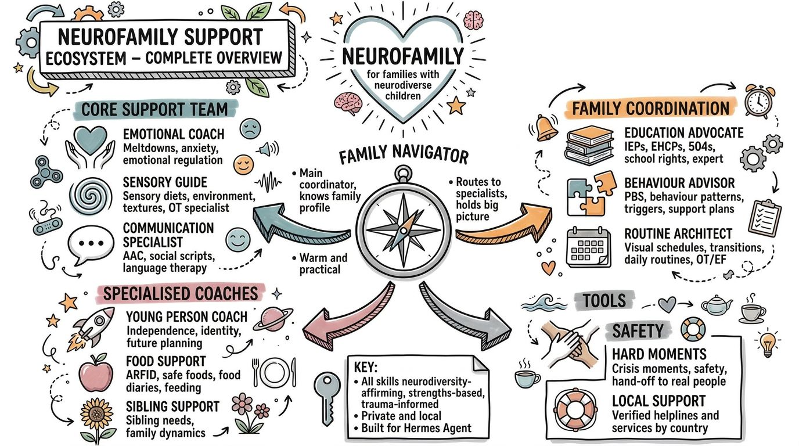

# NeuroFamily Support Ecosystem (Hermes edition)

A multi-agent support ecosystem for families raising neurodiverse children. Built with love for families who deserve support that actually supports them.



---

## What this is

Fifteen specialist support skills that run on **[Hermes Agent](https://hermes-agent.nousresearch.com/docs)**, your own personal AI assistant. Install it once, and the family has a complete support team through the chat app you already use (Telegram recommended).

Think of it as a multidisciplinary team in your pocket: a family coordinator, a school advocate, an OT for sensory and routines, a coach for emotional regulation, a feeding specialist, a carer wellbeing companion, and more, all working together and all sharing one picture of your family.

**Private by design.** Everything runs on your own machine. Your family's information stays with you.

**The Family Navigator** is the front door. It gets to know your family, routes each need to the right specialist, and holds the big picture across everyone.

---

## The support team

| Skill | Focus |
|---|---|
| Family Navigator | Whole-family hub, triage, coordination |
| Emotional Coach | Regulation, anxiety, meltdown recovery, emotional literacy |
| Sensory Guide | Sensory profiles, sensory diets, environment, fine motor |
| Communication Specialist | AAC, speech and language support, social scripts |
| Education Advocate | IEPs, EHCPs, 504s, ILPs, accommodations, school rights |
| Behaviour Advisor | Behaviour patterns, functions, proactive support plans |
| Routine Architect | Visual schedules, transitions, executive function |
| Young Person Coach | Self-advocacy, identity, independence, transition planning |
| Food Support | ARFID, safe foods, food diaries, low-stress mealtimes |
| Sibling Support | Siblings' feelings, identity, fair attention |
| Parent Companion | Carer burnout, grief, respite, wellbeing |
| Hard Moments | Crisis moments, safety, hand-off to real people |
| Local Support | Verified helplines and services by country |
| NDIS Guide | Australian scheme navigation: access, plans, budgets, reviews, from the shipped document library |
| Artifacts Generator | Visual schedules, trackers, dashboards, family mini-apps |

Every skill is neurodiversity-affirming, strengths-based and trauma-informed. See `SOUL.md` for the principles and `AGENTS.md` for how the team works together.

---

## How it works

1. **One shared brain.** All skills read and update a shared family folder (`family-profile.md`, `child-summary.md`, `active-concerns.md`, and more). When one specialist learns something important, the others know.
2. **One front door.** The Family Navigator handles first conversations, profiles your family, and routes to specialists.
3. **Schedules for real family life.** Optional check-ins and nudges through Hermes cron jobs: morning routine anchors, a weekly family check-in, carer wellbeing prompts, and a monthly review. See `schedules/`.
4. **Escalation rails.** The team supports; it never diagnoses, treats or replaces professional care. Crises route to humans immediately. See the rails in every skill.
5. **Optional connections.** With a free Maton account, the team can read the family's Google or Microsoft calendar and mail (real appointments in the weekly check-in, school emails summarised before meetings). Read-first, writes need a yes in the moment. See `docs/connections.md`.
6. **A model for every job.** DeepSeek Flash via OpenRouter by default, frontier models on demand for complex work, and local models encouraged for the scheduled check-ins. Voice is local too: Piper speaks, faster-whisper listens. See `docs/models.md`.

---

## Starter artifacts

Beyond the conversations, the team builds things your family can hold onto: single-file tools that open in any browser, save on your own device and never send data anywhere. The Artifacts Generator personalises each one for your family. Four are ready to start from today, and full instructions for each live in `templates/artifacts/README.md`.

| Artifact | What it is | Best for |
|---|---|---|
| `food-diary.html` | Fillable local diary: safe-food map, meal entries, stress notes, CSV export, print | Food Support families, ARFID tracking, showing patterns to a dietitian |
| `food-diary-sheets.md` | The same diary as a Google Sheet / Excel workbook (spec + formulas) | Families with connections set up; multi-carer households |
| `lesson-chunks.html` | Local-first lesson planner: paste or dictate a lesson and the AI breaks it into small sequential steps with a motivating overview. Text-to-speech, mark-complete, an editor and AI feedback on each step | Autistic young people and executive-function support: turning schoolwork, therapy material or daily tasks into manageable steps |
| `iep-companion.html` | The school's plan turned into something a child can actually use: goals in plain words, sparks and badges, child-chosen themes, questions for the next review, a words-to-know glossary, attendance check-ins and a print view | Every IEP, EHCP or 504 family; preparing for reviews; helping the child understand their own plan |

Lesson Chunks asks for a free OpenRouter key in its settings once (its only internet call, used only when you chunk a lesson or ask a question). The other three need no accounts at all. Everything saves in the browser on your own device, and the Food Diary and IEP Companion both export files you keep.

The IEP Companion, in a little more detail: each goal is re-written in plain words ("what this really means"), with how you practise it and who helps. Every practice session earns a spark, sparks earn badges, and the child picks their own theme (dinosaur jungle included). It also holds the questions to ask at the next review, a glossary for plan jargon, day-by-day check-ins against the school term dates and a print view for meetings. The agent fills it in from your family profile, and the child's copy can live on their own phone or tablet.

---

## Install

See `INSTALL.md`. Short version:

1. Install Hermes Agent (one command, any laptop).
2. Add this profile from the install sheet, or copy `skills/` into your Hermes profile and copy the templates from `shared/`.
3. Have your first conversation with the Family Navigator to build your family profile.
4. Optionally add the schedules from `schedules/`.

---

## Schedules

| Schedule | Rhythm | What it does |
|---|---|---|
| Daily routine anchors | Weekday mornings | Gentle nudge for the morning routine, tied to the visual schedule |
| Weekly family check-in | Sunday evening | Navigator-led: the week ahead, wins, one thing to make easier |
| Carer wellbeing check-in | Wednesday evening | Parent Companion: energy, support, one act of respite planning |
| Sibling check-in | Fortnightly | Sibling Support: a moment that belongs to the sibling |
| Monthly ecosystem review | Monthly | Look back across the team: what worked, what changes |

Setup commands are in `schedules/README.md`.

---

## What changed in the Hermes edition

- The twelve OpenClaw agents are now twelve Hermes **skills** (`skills/<name>/SKILL.md`), with the same souls and tools, plus shared-context and escalation sections.
- **Schedules added** (the OpenClaw edition had none).
- **LICENSE added** (PolyForm Noncommercial 1.0.0 with Required Notice). The previous repo had no license.
- **Local models guide** added to `INSTALL.md` (offline setup via LM Studio or Ollama).
- Shared-context **file templates** added (`shared/`), plus the missing regional template.
- Language standardised on "young people" throughout.
- All OpenClaw references replaced with Hermes equivalents.
- **v2.1.0:** Maton connections, WhatsApp family group, model tiering and local voice.
- **v2.2.0:** artifact pack (food diary), crisis card, communication passport, setup script, and the hard-moments and local-support skills.
- **v2.3.0:** the NDIS guide skill and library (`shared/ndis/`, 59 current official documents).

Full history: `CHANGELOG.md`. What's next: `ROADMAP.md`.

---

## What it is not

- Not therapy, not medical or legal advice.
- Not a replacement for your child's professionals. It helps you get more out of them: better questions, better records, better advocacy.
- Not a companion or a friend substitute for any child. It is a support tool that works for the family.
- **Not a crisis service, and it never pretends to be one.** In a hard moment it stops, responds with care, points to the family's verified local lines, and hands the matter to a real person. See `skills/hard-moments/`.

## Repository layout

```
skills/            15 specialist skills (each SKILL.md), incl. hard-moments, local-support and ndis-guide
shared/            the shared brain: family folder templates, regional resources + verified
                   local-support packs (crisis and service lists by country),
                   and the NDIS library (shared/ndis)
schedules/         ready-to-install check-ins and nudges
SOUL.md            the principles every skill lives by
AGENTS.md          how the team works together
INSTALL.md         full setup guide (including fully-offline local models)
PROFILE_BUILDER.md the guided family onboarding
config.yaml        example Hermes configuration
templates/         starter artifacts (food diary, IEP Companion and friends)
scripts/           setup-family-folder.py - one-command family folder setup
docs/              design document + connections, models and local-models guides
```

---

## License

PolyForm Noncommercial License 1.0.0. Free to use, change and share for any noncommercial purpose, with credit. See `LICENSE`.

Required Notice: Copyright 2026 Brendan O'Keefe (https://onetoeight.org)

Original OpenClaw edition designed March 2026. Hermes edition rebuilt October 2026.
